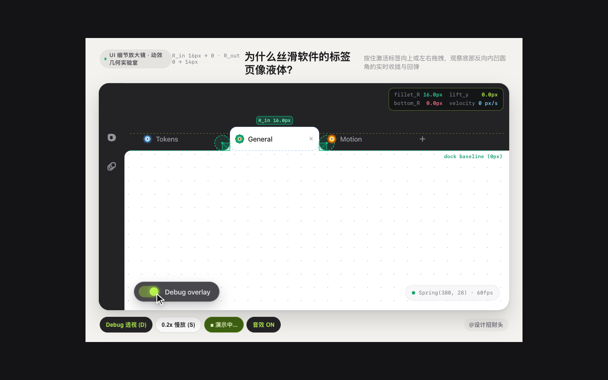

# Liquid-Fillet Draggable Browser Tab

**Zero-dependency 60fps liquid-fillet draggable browser tab** built with a single closed SVG `<path>`, second-order damped spring physics, and a real-time tangent-circle geometry debug overlay.

[](LICENSE)
[](#)
[](index.html)

👉 **[Live Interactive Demo](https://hmkkaii.github.io/liquid-fillet-tab/)** · **[中文使用与部署指南](#中文指南)**

[](https://hmkkaii.github.io/liquid-fillet-tab/)

*Click the preview above to play with the live 60fps demo (press `D` for geometry tangent circles, `S` for `0.2×` slow-motion).*

---

## Why I Built This

Most browser tabs fake bottom concave corners using overlapping pseudo-elements or bitmaps, which often show hairline seams and break the moment a tab detaches mid-drag.

This prototype computes the **entire tab silhouette + both concave bottom fillets (`16px`) as a single continuous closed SVG `<path>`**, driven by real **2nd-order damped spring physics** (`Spring(380, 28)`):

- **Zero hairline seams**: One continuous SVG path morphs smoothly from docked concave fillets into a floating pill as you peel the tab upward.
- **Interruptible spring reordering**: Drag horizontally across neighboring tab midlines to feel neighbors slide out of the way with velocity-preserving spring physics.
- **Built-in Geometry Debugger (`D`)**: Toggle live emerald (`R_in`) and coral (`R_out`) tangent-circle construction overlays to inspect how the math works frame by frame.
- **Zero dependencies, single file**: Everything lives in [`index.html`](index.html) — open it directly in any browser with no `npm install` or build step.

---

## Interactive Controls & Shortcuts

| Action / Key | Effect |
| :--- | :--- |
| **Drag Up** | Peel a tab out of the tab bar and watch the `16px` concave bottom fillets smoothly collapse into a floating pill |
| **Drag Left / Right** | Reorder tabs smoothly across midlines with 2nd-order damped spring displacement |
| **`D`** | Toggle the **Debug Geometry Overlay** (`R_in` emerald & `R_out` coral tangent circles) |
| **`S`** | Toggle **`0.2×` Slow-Motion Microscope** (5× slower physics time step) |
| **`H`** | Toggle clean **Screen-Recording Mode** (hides chrome; press `Esc` to restore) |

---

## Quick Start & Physics Presets

### 1. Run Locally (1 Second)
Clone or download this repository and open [`index.html`](index.html) directly in Chrome, Safari, or Edge.

```bash
git clone https://github.com/hmkkaii/liquid-fillet-tab.git
cd liquid-fillet-tab
open index.html
```

### 2. Tune the Feel in 30 Seconds (`USER_CONFIG`)
Lines **9–59** of [`index.html`](index.html) expose `window.USER_CONFIG` for instant parameter experimentation:

| Preset Feel | `USER_CONFIG` Values | Visual / Tactile Behavior |
| :--- | :--- | :--- |
| **Jelly Bounce** | `SPRING_STIFFNESS: 420`, `SPRING_DAMPING: 11`, `MAX_TILT_DEG: 9` | Playful overshoot & lively tilt while dragging and snapping back |
| **Liquid Mercury** | `MAX_FILLET_R: 26`, `MAX_BOTTOM_R: 22`, `PEEL_DIST: 44` | Deeper, more dramatic liquid-pull concave bridges while detaching |
| **Crisp Native** | `SPRING_STIFFNESS: 380`, `SPRING_DAMPING: 28`, `MAX_TILT_DEG: 4` | Tight, high-precision native macOS/browser tab feel (default) |

---

## Repository Contents

- [`index.html`](index.html) — Complete zero-dependency single-file source code (`USER_CONFIG` at lines 9–59).
- [`01_How_to_Play_and_Deploy_Guide.pdf`](01_How_to_Play_and_Deploy_Guide.pdf) — Illustrated Chinese quickstart & 1-minute deployment guide.
- [`02_Formula_and_Vibe_Coding_Prompt.pdf`](02_Formula_and_Vibe_Coding_Prompt.pdf) — 4-step mathematical derivation & Vibe Coding prompt handbook.

---

## Reuse & Attribution

Licensed under the **[MIT License](LICENSE)** — free to study, adapt, and embed in personal or commercial projects.

If you reference the SVG liquid-fillet geometry or spring-tab mechanics in a blog post, prototype, or component library, a link back is greatly appreciated:

```text
Inspired by Liquid-Fillet Tab by Zhenkai (https://github.com/hmkkaii/liquid-fillet-tab)
```

---

<a id="中文指南"></a>

## 中文指南（快速上手与二次创作）

本项目使用 **纯原生 HTML + 单条闭合 SVG `<path>` + 二阶阻尼弹簧** 实现 60fps 液态内凹圆角拖拽标签页，无需 Node.js 或任何构建工具：

1. **1 秒本地运行**：直接双击仓库里的 `index.html` 用浏览器打开即可交互；按 **`D`** 开关几何相切圆透视层，按 **`S`** 开关 `0.2x` 慢动作显微镜，按 **`H`** 进入纯净录屏视图。
2. **30 秒魔改手感**：修改 `index.html` 开头第 9~59 行的 `window.USER_CONFIG`（刚度、阻尼、圆角半径、剥离距离）保存刷新即生效。
3. **1 分钟免费部署**：Fork 本仓库后在 `Settings → Pages` 选择 `Deploy from a branch (main / root)`，约 1 分钟即可生成公开在线链接。
4. **配套手册**：仓库内附有中文图文部署指南与 4 步数学公式 + Vibe Coding 复刻 Prompt 手册（PDF）。

*Created by [Zhenkai (@hmkkaii)](https://github.com/hmkkaii) · `@设计招财头 · UI 细节放大镜系列`*
